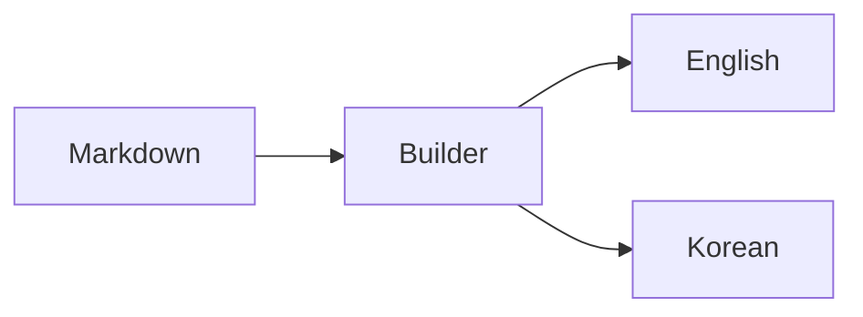

# Building the documentation

The documentation is a static HTML site rendered from Markdown by the project's
Python builder. It uses Jinja2 templates and Pygments for code highlighting.

This is a contributor guide for building the documentation website. Package
installation is covered in [getting started](01-getting-started.md).

## Build and preview locally

Run from a repository checkout with Python 3.10+ and uv 0.13.7+:

```sh
uv sync --locked --all-extras --group docs --group examples
uv run --no-sync python scripts/build_docs.py
python -m http.server 8000 --directory site
```

Open `http://localhost:8000/` for English and `http://localhost:8000/ko/` for Korean.
The build executes the Python examples, generates DOCX and source ZIP downloads,
then renders both languages. It checks local links, anchors, paired translations,
search indexes and downloads before replacing the output directory.
Use `--output PATH` to build into another generated directory.

## Edit content and layout

| Content | Source |
| --- | --- |
| English / Korean guides | `docs/*.md` / `docs/ko/*.md` |
| Navigation in both languages | `docs_site/navigation.json` |
| Page template, design tokens and behavior | `docs_site/page.html`, `site.css`, `site.js` |
| Example titles and descriptions | `examples/catalog.json`, `catalog.ko.json` |
| Executable example code | `examples/` |
| Markdown rendering and link validation | `scripts/site_builder.py` |

Add each page in both languages and list it in each navigation. Preserve published
URLs when changing page names or navigation. Edit generated example
pages through the catalogs and Python sources; builds regenerate their Markdown.

Search runs in the browser against a local, language-specific JSON index.
It supports substring queries for English, Korean and API names. Search results
are inserted as text, not HTML. Content and navigation remain readable without
JavaScript; search, copy buttons and diagram rendering require JavaScript.

## Mermaid diagrams

Use a fenced `mermaid` block to include a diagram:



Diagrams render on the documentation website. The package's `parse_markdown()`
preserves Mermaid fences as code; insert a rendered image to put a diagram in DOCX.

The builder downloads Mermaid 12.3.0 from npm, verifies the pinned SHA-512 and
serves the bundle, its license and the bundled DOMPurify license locally. Diagrams run in an isolated iframe
with scripts allowed and same-origin access denied. Strict mode, plain-text
labels and size/edge limits are fixed by the site. Diagram directives and YAML
configuration are rejected; source remains available if rendering fails.

Markdown HTML is sanitized with an allow list. The site also applies a Content
Security Policy that permits its own assets and blocks inline scripts, external
frames and object embeds. Search results use text nodes and local page URLs.

## Deployment

In GitHub, set **Settings → Pages → Build and deployment → Source** to
**GitHub Actions**. The `Documentation` workflow builds pull requests and develop
pushes; it deploys only master builds to the `github-pages` environment.

Do not commit the generated `site/`, DOCX files or example output folders.
To refresh reference PDFs, install LibreOffice Writer, Math, fonts and Poppler,
then use [the rendering checks](11-validation.md#libreoffice). PDF previews are
separate from editable DOCX downloads.
